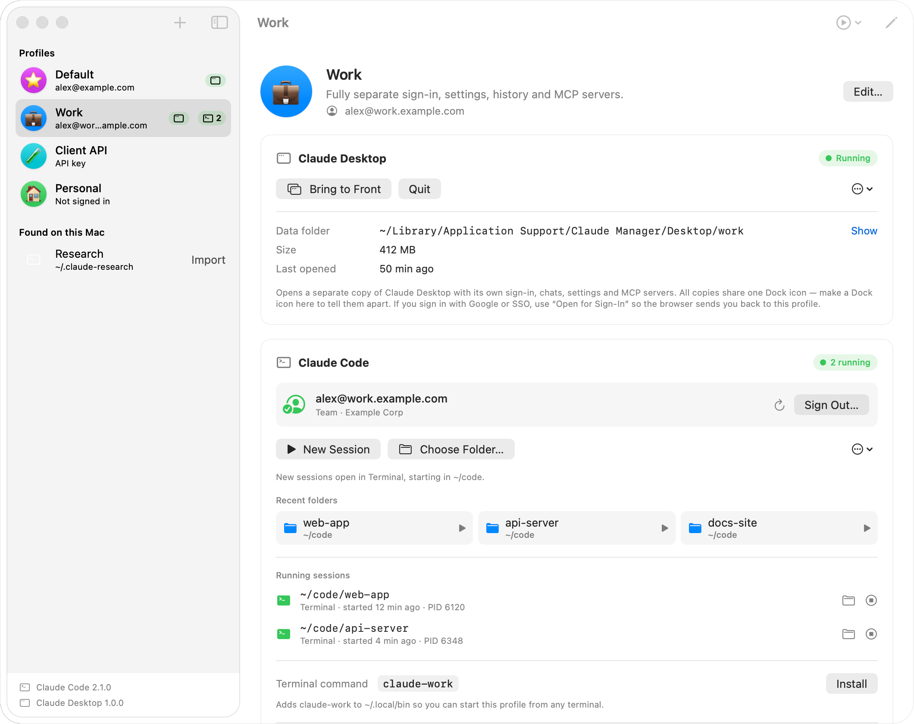
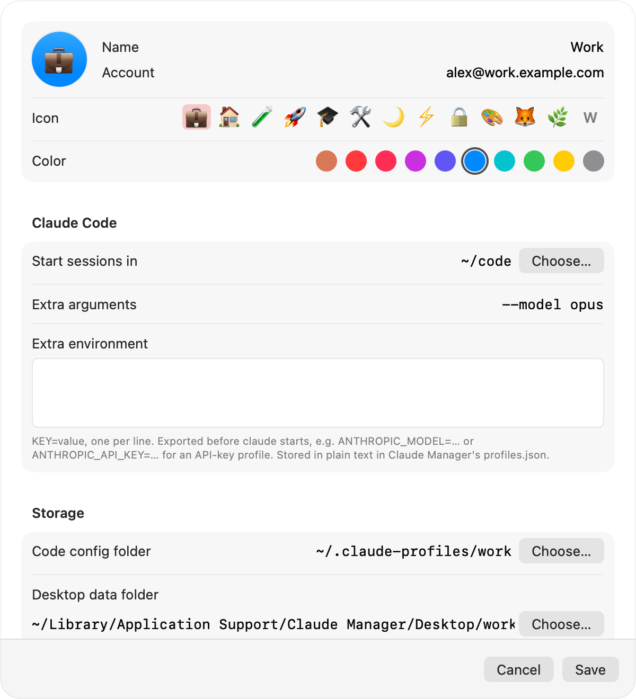
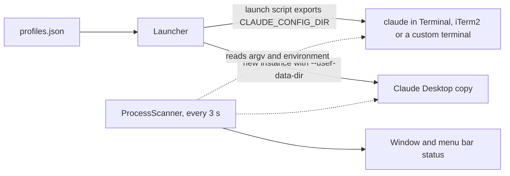

# Profiles for Claude: run multiple Claude Code and Claude Desktop accounts on one Mac

[](LICENSE)


> **Unofficial.** This project is not made by, affiliated with or endorsed by Anthropic. Claude, Claude Code and Claude Desktop are trademarks of Anthropic, PBC, named here only to say what the app works with. The app itself is called **Claude Manager**.

**A free, open-source (MIT) macOS app that runs several Claude Code and Claude Desktop accounts side by side, each in its own isolated profile.** Keep a work account, a personal account and an API-key setup signed in at the same time, and start any of them from the app window, the menu bar, a Dock icon or a `claude-<name>` terminal command. It uses the switches the Claude apps already support (`CLAUDE_CONFIG_DIR` for Claude Code, Electron's `--user-data-dir` for Claude Desktop), leaves sign-ins to the Claude apps themselves, makes no network requests of its own and has no third-party dependencies.

<p align="center">
  
</p>
<p align="center"><sub>Rendered from the app's SwiftUI views with fictional data.</sub></p>

By default, Claude Code and Claude Desktop each keep one sign-in per macOS user. With more than one account you either sign out and back in, or juggle `CLAUDE_CONFIG_DIR` and Electron flags by hand. This app gives each account its own folders and starts the right copy for you:

- **Use a work and a personal Claude account on one Mac** without signing out. Each profile keeps its own sign-in.
- **Run two or more Claude Desktop windows signed in to different accounts** at the same time.
- **Keep Claude Code settings separate per account**: `settings.json`, `CLAUDE.md`, MCP servers, agents, skills and history.
- **Start the right account from anywhere**: a `claude-work` command in any terminal, a Dock icon per profile, or the menu bar.
- **See what's running under which account**, including sessions you started by hand, and stop them.

## Contents

- [Features](#features) · [Quick start](#quick-start) · [Configuration](#configuration) · [How it works](#how-it-works)
- [Where sign-ins and keys are stored](#where-sign-ins-and-keys-are-stored) · [FAQ](#faq) · [Limitations](#status-and-limitations) · [Contributing](#contributing) · [License](#license)

## Features

**Profiles**

- Each profile has a name, an emoji or initial, a color, an optional account label, extra `claude` arguments, extra environment variables and a default start folder.
- A built-in **Default** profile points at your existing `~/.claude`, `~/.claude.json` and Claude Desktop data. Nothing is moved.
- A new profile can start with a copy of Default's `settings.json`, `CLAUDE.md`, agents, commands, skills, output styles, keybindings, user MCP servers and Claude Desktop config file. Sign-ins and history are never copied.
- A profile can adopt a folder you already use with `CLAUDE_CONFIG_DIR` or `--user-data-dir`, and keeps that folder's sign-in.
- **Found on this Mac:** if a running Claude Code session or Claude Desktop copy uses a folder that no profile covers, the sidebar offers to import it or ignore it.
- Profiles can be reordered by dragging in the sidebar.

**Claude Desktop**

- Open, bring to front or quit each profile's copy of Claude Desktop.
- **Open for Sign-In** quits the other copies first. A Google or SSO sign-in returns through a `claude://` link, and macOS hands that link to whichever copy is running.

**Claude Code**

- Start a session in the profile's default folder, a recent folder (the last 8 are kept) or a folder you pick.
- Sessions open in Terminal, iTerm2, or any terminal through a custom command template with `{script}` and `{dir}` placeholders (for example Ghostty, Warp or WezTerm).
- After `claude` exits, the window stays in a login shell that still has the profile's environment.
- Sign-in status comes from the profile's `.claude.json` and from `claude auth status --json`. **Sign In** runs `claude auth login` in a terminal and then starts a session. **Sign Out** runs `claude auth logout`.
- **Update Claude Code** runs `claude update` once. All profiles share one install.

**Live status**

- Shows running Claude Desktop copies and Claude Code sessions per profile, with each session's folder, start time and PID, and a Stop button.
- Process data is read from the kernel, so sessions you started by hand are found too. Sessions started from Claude Desktop's built-in Code tab are labelled as such. Child `claude` processes (subagents, tools) are not counted as sessions.
- Shows the disk size of each profile's folders.

**Launching from outside the app**

- Install a `claude-<slug>` command (in `~/.local/bin` by default) to run a profile from any terminal, for example `claude-work -c`. The app warns if that folder isn't on your shell's `PATH`.
- Create a small Dock launcher `.app` per profile, with an icon badged in the profile's color and emoji.
- A menu bar menu with quick launch for every profile.
- A headless command-line mode (see [Command-line use](#command-line-use)).

**Sharing settings between profiles**

- Copy or symlink `settings.json`, `CLAUDE.md`, agents, commands, skills, output styles, keybindings, plugins, the Claude Desktop config file and Desktop extensions from one profile to another.
- User-scope MCP servers are merged into the target's `.claude.json` without touching the account stored there.

## Quick start

You need macOS 13 or later and the Xcode Command Line Tools (`xcode-select --install`). Full Xcode isn't needed. Install Claude Code and/or Claude Desktop the usual way; if either is missing, the app shows a notice with a download link.

```bash
git clone https://github.com/hanshika0292/profiles-for-claude.git
cd profiles-for-claude
./build.sh                       # builds build/Claude Manager.app (universal: Apple silicon + Intel)
open "build/Claude Manager.app"
```

- `./build.sh --install` also copies the app to `~/Applications`, quitting a running copy first.
- `ARCHS=arm64 ./build.sh` (or `ARCHS=x86_64`) builds for one architecture, which is quicker.

On first launch, **Default** is already there. Click **+** to add a profile, then open Claude Desktop or start a Claude Code session from it and sign in once. It stays signed in after that.

### Package a DMG

```bash
./make-dmg.sh             # builds build/Claude-Manager-<version>.dmg
./make-dmg.sh --install   # same, and installs locally
```

The DMG holds the app and an Applications shortcut. If `dist/Read Me First.txt` exists, it is added too. The app is ad-hoc signed, not notarized, so whoever installs it from a DMG has to approve it once in System Settings → Privacy & Security. Building from source avoids that step.

### Command-line use

The app binary also works headless, which is what Dock launchers use:

```bash
M="$HOME/Applications/Claude Manager.app/Contents/MacOS/ClaudeManager"
"$M" --launch-code work --folder ~/code/example-project   # profile by slug or id
"$M" --launch-desktop work
"$M" --list-running                                       # what's running, grouped by profile
```

### Uninstall

```bash
rm -rf ~/Applications/"Claude Manager.app" ~/Applications/"Claude Manager" \
       ~/Library/Application\ Support/"Claude Manager"
defaults delete local.claudemanager.app
rm ~/.local/bin/claude-<slug>   # each terminal command you installed from the app
# Profile data, if you want it gone too: ~/.claude-profiles/
```

Removing `~/Library/Application Support/Claude Manager` also removes the Claude Desktop data of every profile whose Desktop folder is there, which is where new profiles put it. Sign out of each profile first if you want Claude Code to forget those logins too (see [below](#where-sign-ins-and-keys-are-stored)).

## Configuration

**Profiles** live in `~/Library/Application Support/Claude Manager/profiles.json`. You normally edit them in the app. [`profiles.example.json`](profiles.example.json) shows the format.

**Preferences** are set in the Settings window and stored in the `local.claudemanager.app` defaults domain: `terminal`, `customTerminalTemplate`, `claudePathOverride`, `desktopAppOverride`, `commandsDir`, `showMenuBarExtra`. The app also keeps `ignoredFolders` and `welcomeDismissed` there.

**Environment variables.** The app itself needs none.

| Variable | Set by | Purpose |
|---|---|---|
| `ARCHS` | you, for `build.sh` | Architectures to build. Default `x86_64 arm64` |
| `CLAUDE_CONFIG_DIR` | the app, for every non-default profile | Points Claude Code at the profile's folder, e.g. `~/.claude-profiles/work`. Unset for Default |
| `CLAUDE_MANAGER_PROFILE` | the app | The profile's name, exported by Claude Code launch scripts (including Code Dock launchers) and `claude-<slug>` commands |
| Anything in a profile's **Extra environment** | you, in the profile editor | `KEY=value` per line, exported before `claude` starts, e.g. `ANTHROPIC_MODEL=opus` or `ANTHROPIC_API_KEY=your-key-here`. Stored in plain text |

<p align="center">
  
</p>

## How it works

Isolation uses two switches that the Claude apps already respect:

| | Default profile | Any other profile |
|---|---|---|
| **Claude Code** | `~/.claude` + `~/.claude.json` | `CLAUDE_CONFIG_DIR=~/.claude-profiles/<slug>` |
| **Claude Desktop** | `~/Library/Application Support/Claude` | `--user-data-dir=~/Library/Application Support/Claude Manager/Desktop/<slug>` |

- **Claude Code** keeps its settings, history, agents, skills, plugins, user MCP servers and account details in the folder named by `CLAUDE_CONFIG_DIR` (`.claude.json` sits inside that folder), and keeps a separate login per folder. The app exports it in every launch for a non-default profile, and explicitly unsets it for Default.
- **Claude Desktop** is an Electron app. Electron ties its single-instance lock and cookies to the user-data folder, so starting `Claude.app` as a new instance with a different `--user-data-dir` gives a separate copy with its own sign-in.

The Code folder root (`~/.claude-profiles`) has no spaces on purpose, because hooks and plugins sometimes put `CLAUDE_CONFIG_DIR` into shell commands unquoted.



The main pieces:

- **Launcher** writes a short, self-deleting `.command` script for each Claude Code session. The script changes to the folder, clears inherited variables, exports the profile's environment and runs `claude`. Terminal opens it through `NSWorkspace`, so no Automation permission is needed. iTerm2 is driven with AppleScript. The custom option runs your template with `/bin/sh`. Claude Desktop copies are started with `NSWorkspace.openApplication` and `createsNewApplicationInstance`.
- **ProcessScanner** runs every 3 seconds and whenever an app launches or quits. It lists PIDs with libproc, keeps processes owned by the current user that look like Claude Desktop's main process or Claude Code, and reads their arguments and environment with `sysctl(KERN_PROCARGS2)`. `--user-data-dir` and `CLAUDE_CONFIG_DIR` match each process to a profile.
- **Toolchain** finds the `claude` binary (known install paths first, then your login shell) and `Claude.app`. GUI apps don't inherit your shell's `PATH`, so it reads `PATH` from your login shell once.
- **Inherited environment.** If Claude Manager is started from a terminal or a Claude Code session, it drops that terminal's identity variables (`COLORTERM`, `TERM_PROGRAM`, ...) and Claude Code's session markers (`CLAUDECODE`, `CLAUDE_CODE_CHILD_SESSION`, ...). Launch scripts clear them again. Otherwise new sessions would think they are subagents and stop saving transcripts, and Terminal.app before macOS 26 would receive 24-bit color it can't show.
- **SettingsSync** copies or symlinks items between profile folders and merges the `mcpServers` key between `.claude.json` files.
- **Headless mode.** The same binary handles `--launch-code`, `--launch-desktop` and `--list-running`, so Dock launchers and scripts can start profiles without opening the window.

### What it reads and writes on your Mac

| Location | Access | Purpose |
|---|---|---|
| `~/Library/Application Support/Claude Manager/profiles.json` | read/write | The profile list |
| `~/Library/Application Support/Claude Manager/run/` | write | Temporary launch scripts; each deletes itself when it runs |
| `~/.claude-profiles/<slug>/` | create | Claude Code data for new profiles |
| `~/Library/Application Support/Claude Manager/Desktop/<slug>/` | create | Claude Desktop data for new profiles |
| `~/.claude.json` and each profile's `.claude.json` | read; write on MCP merge | Account email and organization, user-scope MCP servers |
| Profile folders | write on request | Share settings, or move to Trash when you delete a profile |
| `~/.local/bin/claude-<slug>` (configurable) | write on request | Terminal commands |
| `~/Applications/Claude Manager/` | write on request | Dock launcher apps |
| Your own Claude processes | read; signal on request | Live status; Stop sends `SIGTERM`, Quit asks the app to quit |

The app makes no network requests of its own. It runs the `claude` CLI for sign-in, sign-out, status and version checks, and `claude update` when you ask.

## Where sign-ins and keys are stored

Claude Manager never reads, copies or stores sign-in tokens or passwords, and it doesn't use the macOS Keychain.

- **Claude Code logins** are handled by Claude Code itself. The app only starts `claude` with the profile's `CLAUDE_CONFIG_DIR`, and runs `claude auth login`, `claude auth logout` and `claude auth status --json` with that environment. On macOS, Claude Code keeps its credentials in the macOS Keychain, outside the profile folder, so deleting a profile's folder doesn't remove its login. Sign out first if you want it gone; the delete dialog says the same.
- **Account details shown in the app** (email, organization, plan, sign-in method) come from the `oauthAccount` key in the profile's `.claude.json` and from `claude auth status --json`. They are kept in memory for display, not saved.
- **Claude Desktop logins** stay in that copy's data folder, where Electron keeps its cookies and session data. The app doesn't read them.
- **Extra environment values**, such as an `ANTHROPIC_API_KEY`, are the exception: they are yours, and the app stores them in plain text in `profiles.json`. They are also written into the temporary launch scripts and into installed `claude-<slug>` commands (file mode 755), and included in **Copy Launch Command**. If you'd rather not keep a key there, use the profile's **Sign In** (`claude auth login`) instead.
- **Sharing settings copies files as they are.** If `settings.json`, `claude_desktop_config.json` or an MCP server entry contains a token (for example in an `env` block), the target profile gets it too.

## FAQ

**How do I use two Claude accounts on one Mac?**
Create a profile for each account with **+**, open Claude Desktop or start Claude Code from that profile, and sign in once. Default keeps the account you already use. Each profile then stays signed in to its own account.

**Can I run two Claude Desktop apps at the same time with different accounts?**
Yes. Each profile's Claude Desktop is a separate instance with its own `--user-data-dir`, so it has its own sign-in, chats, settings and MCP servers. All copies share Claude's Dock icon, so make a Dock launcher per profile to tell them apart. For a Google or SSO sign-in, use **Open for Sign-In** so the browser hands the sign-in back to the right copy.

**How do I switch Claude Code accounts without logging out?**
You don't switch: each profile runs `claude` with its own `CLAUDE_CONFIG_DIR`, so several accounts can have sessions open at once. Install the profile's terminal command and run `claude-work` (or whatever the profile is called) in any terminal. Arguments pass through, e.g. `claude-work -c`.

**What is `CLAUDE_CONFIG_DIR` and can I do this without the app?**
It's the environment variable that tells Claude Code which folder to use for its configuration and data. You can do the Claude Code part by hand with `CLAUDE_CONFIG_DIR=~/.claude-profiles/work claude`, and the Claude Desktop part with `open -n -a Claude --args --user-data-dir=<folder>`. The app keeps track of the folders, launchers, sign-in status and running sessions for you.

**Does it store my Claude password or tokens?**
No. Logins are handled by Claude Code and Claude Desktop themselves. The one thing the app stores that may be secret is whatever you type into a profile's Extra environment, which is kept in plain text. See [Where sign-ins and keys are stored](#where-sign-ins-and-keys-are-stored).

**Is this an official Anthropic app?**
No. It's an independent open-source project that starts the official Claude apps with options they already support. It is not affiliated with or endorsed by Anthropic.

**Will it change my existing Claude Code or Claude Desktop setup?**
Not unless you ask. Default points at your existing folders and nothing is moved. The app writes to them only when you share settings into Default, merge MCP servers into it (which rewrites `~/.claude.json` and keeps one backup), or sign in or out.

**Can I make a profile that uses an Anthropic API key?**
Yes. Put `ANTHROPIC_API_KEY=...` in the profile's Extra environment and Claude Code started from that profile will see it. Keep in mind it is stored in plain text.

## Status and limitations

- Version 1.0.3. A working personal tool. There are no automated tests.
- macOS only (13+). Builds are ad-hoc signed and not notarized, and there is no prebuilt download.
- Parts of it depend on behavior that isn't a documented, stable interface: Claude Desktop honoring Electron's `--user-data-dir`, the JSON from `claude auth status --json`, the `oauthAccount` and `mcpServers` keys in `.claude.json`, and the executable paths used to recognize Claude processes. An update to either Claude app could break a feature. Unusual install layouts may not be detected.
- All Claude Desktop copies share Claude's Dock icon and the name "Claude" in ⌘-Tab. Dock launchers and account labels help tell them apart. If a profile's copy is running, clicking the regular Claude icon focuses that copy instead of starting Default. Open Default from Claude Manager instead.
- iTerm2 asks once for Automation permission. Terminal doesn't need any.

Safety notes:

- **Secrets in plain text.** Extra environment values are stored in plain text in `profiles.json`, written into the temporary launch scripts and installed `claude-<slug>` commands (file mode 755), and included in Copy Launch Command.
- **Sharing settings replaces files.** Items in the target profile that get replaced are moved to the Trash. If moving to the Trash fails, they are deleted. Linked items are symlinks, so editing one changes every linked profile.
- **MCP merge rewrites `.claude.json`.** The target file is rewritten (formatting and key order may change) and set to mode 600. One backup is kept next to it as `.claude.json.claude-manager-backup` and replaced on each merge. When the target is Default, this is `~/.claude.json`. Restart running sessions afterwards.
- **Deleting a profile** asks whether to keep its folders or move them to the Trash. It never trashes the default Claude folders, your home folder or a folder another profile uses. To make Claude Code forget that profile's saved login too, sign out first. A profile can't be deleted while it is running.
- **Stopping and quitting.** Stop sends `SIGTERM` to a Claude Code session. Open for Sign-In quits the other Claude Desktop copies.
- **Shell startup files run.** To find `PATH` and `claude`, the app runs your login shell interactively (`$SHELL -l -i -c ...`), which runs your shell startup files.
- **Process inspection.** The app reads the arguments and environment of your own Claude processes, and of your Node.js processes to spot npm installs of Claude Code. It only uses `--user-data-dir` and `CLAUDE_CONFIG_DIR` from them.
- **Generated files.** Terminal commands and Dock launchers carry a `# managed-by: Claude Manager` marker. The app won't overwrite or remove a terminal command without it, and only moves marked Dock launchers to the Trash. Creating a Dock launcher replaces any app already at the same path in `~/Applications/Claude Manager/`.

## Project structure

```
Sources/
  Main.swift               Entry point, window/settings/menu bar scenes, headless mode
  AppModel.swift           App state, profiles.json load/save, user actions
  Profile.swift            Profile model, folder resolution, extra-env parsing
  Paths.swift              Well-known folders, all derived from the home directory
  Launcher.swift           Desktop and Code launching, launch scripts, claude-<slug> commands, Dock launchers
  ProcessScanner.swift     libproc/sysctl scan of running Claude processes
  Toolchain.swift          Finds claude, Claude.app and terminals; inherited-environment cleanup
  Accounts.swift           Sign-in status, disk usage
  SettingsSync.swift       Copy/link settings between profiles, MCP server merge
  Shell.swift              Process runner, shell quoting, preference keys
  IconRenderer.swift       App icon and Dock launcher icons drawn in code
  ContentView.swift        Main window, sidebar, toolchain footer
  ProfileDetailView.swift  Profile page: Desktop, Code and Maintenance cards
  ProfileEditor.swift      New/edit profile sheet
  SyncSheet.swift          Share-settings sheet
  SettingsView.swift       Settings window
  MenuBarContent.swift     Menu bar menu
  Components.swift         Shared SwiftUI views and date formatting
  Bridging.h               Exposes libproc to Swift
docs/                      Screenshots and the social preview image
Info.plist                 App bundle metadata (version, bundle ID, minimum macOS)
build.sh                   Build script (swiftc, lipo, iconutil, codesign)
make-dmg.sh                DMG packaging
profiles.example.json      Example of the profiles file format
LICENSE                    MIT License
THIRD_PARTY_NOTICES.md     Third-party and trademark notices
```

Built with Swift, SwiftUI and AppKit (`NSWorkspace`, `NSOpenPanel`, `NSAppleScript`, `MenuBarExtra`), Darwin libproc (`proc_listallpids`, `proc_pidpath`, `proc_pidinfo`) through a one-line bridging header, `sysctl(KERN_PROCARGS2)`, and Foundation `Process` to call the `claude` CLI. There's no Xcode project, Swift package or third-party dependency. `build.sh` calls `swiftc` per architecture, merges the binaries with `lipo`, has the app draw its own icon, converts it with `iconutil` and ad-hoc signs with `codesign`. The app icon and Dock launcher badges are drawn in code; there are no image assets.

## Contributing

Bug reports and pull requests are welcome, especially reports of a Claude Code or Claude Desktop update that broke a feature, or an install layout the app doesn't detect. There are no automated tests yet, so please say how you checked a change: `./build.sh` must succeed, and a quick run through creating a profile, starting a session and opening Claude Desktop catches most problems. By contributing, you agree that your contribution is licensed under the MIT License.

## Credits

Profiles for Claude builds only on Apple's frameworks and contains no third-party code (see [THIRD_PARTY_NOTICES.md](THIRD_PARTY_NOTICES.md)). It works with [Claude Code](https://docs.claude.com/en/docs/claude-code/setup) and [Claude Desktop](https://claude.ai/download) by Anthropic, using Claude Code's `CLAUDE_CONFIG_DIR` setting and Electron's `--user-data-dir` switch.

## License

Released under the [MIT License](LICENSE). Copyright (c) 2026 Hanshika Gupta.

You can use, copy, modify and redistribute it, including commercially, as long as you keep the copyright and license notice. `build.sh` copies `LICENSE` and `THIRD_PARTY_NOTICES.md` into the app bundle (`Claude Manager.app/Contents/Resources/`), so they travel with any copy of the app. The software comes with no warranty.
